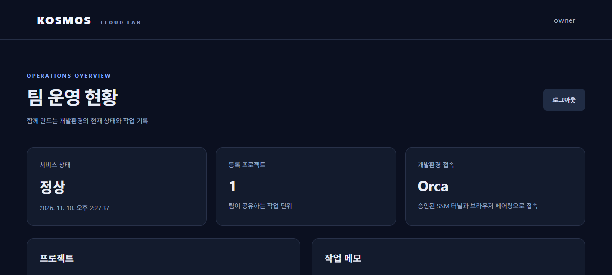

# KOSMOS Cloud

KOSMOS Cloud는 AWS EC2 한 대에서 팀이 Orca로 공동 개발하고 프로젝트와 업무를 관리할 수 있도록 만든 운영 포털입니다. Orca는 편집기·터미널·AI 도구 실행을, Webmin은 서버 관리를 담당합니다. 팀은 운영 포털과 API, 데이터 모델, 권한 검사, 저장소 연결, 상태 점검과 백업 기능을 구현했습니다.

## 주요 기능

- **프로젝트 관리** — 소유자와 공개 범위를 설정하고, 연결된 Orca 개발환경과 GitHub 저장소를 엽니다.
- **팀 협업** — 전체·그룹·1:1 채팅, 계정별 공지 확인 상태, 담당자와 마감일이 있는 할 일, 작업 메모와 첨부 파일을 제공합니다.
- **접근 관리** — 로그인 상태와 프로젝트 권한을 확인한 뒤 개발환경과 첨부 파일에 접근을 허용합니다. 관리자는 계정과 세션을 관리합니다.
- **운영과 복구** — 서비스 상태를 정기적으로 점검하고, 업무 데이터와 코드를 백업해 별도 환경에서 복원할 수 있습니다.

## 시스템 구성

브라우저의 HTTPS 요청은 EC2의 Nginx를 거쳐 FastAPI 포털, Orca 또는 Webmin으로 전달됩니다. 포털은 업무 데이터를 비공개 RDS MySQL에 저장하고, 첨부 파일과 백업은 비공개 S3에 보관합니다. 자세한 연결 관계는 [구성도](docs/architecture.md)를 참고하세요.

## 사용 방법

1. 운영자가 안내한 HTTPS 포털에서 로그인합니다.
2. **프로젝트 → Orca에서 개발환경 열기**를 선택합니다. 저장소를 연결한 프로젝트는 같은 화면에서 GitHub도 열 수 있습니다.
3. **대시보드 → 팀 변경사항**에서 공지를 확인하고, **팀 채팅**, **할 일**, **작업 메모**에서 진행 상황을 공유합니다.
4. 점검·백업 이력은 대시보드에서 최근 3개를 기본으로 보여주고, 목록을 펼치면 최대 100개까지 볼 수 있습니다.

자세한 화면과 사용 순서는 [사용 안내](docs/user-guide.md)를 참고하세요. 서버 관리자용 SSM 터널과 로컬 접속 절차는 [접속·배포 가이드](docs/deployment.md)에 있습니다.

## 검증 결과

2026년 11월 18일 기준으로 다음 동작을 확인했습니다.

- **AI 개발과 GitHub 반영** — AWS의 Orca에서 Codex가 `demo_add.py`를 작성하고 서버 Python으로 검증 3개를 통과했습니다. 코드와 실행 안내를 담은 README를 예제 저장소에 반영했습니다. [GitHub 예제 저장소](https://github.com/qkrcksdnr0605-dotcom/aws-todolist)
- **팀 협업** — 팀이 서로 다른 세 계정으로 동시 접속해 대화했고, 계정별 공지 확인 상태와 재로그인 후 새 공지 수신을 직접 확인했습니다.
- **접근과 복원** — 공개 HTTPS 상태 확인과 비로그인 요청의 보호 경로 접근 차단을 확인했습니다. 업무 백업을 별도 SQLite 환경에 복원해 27개 테이블과 145행을 확인했습니다.

## 운영 범위

현재 개발환경과 포털은 단일 EC2에서 운영합니다. Orca가 공유 운영체제 계정을 사용하므로 사용자별 프로세스와 파일 격리는 후속 과제입니다. 장애 알림의 실제 메일 수신과 실계정 2단계 인증 등록은 별도 검증 항목입니다.

## 관련 문서

- [진행 상태](STATUS.md) · [검증 이력](docs/verification.md) · [과거 AWS 시연 기록](docs/course-demo.md)
- [Orca와 GitHub 사용법](docs/orca-workflow.md) · [포털 운영·복구](docs/portal-operations.md)
- [데이터 모델](docs/data-model.md) · [비용과 자동 중지](docs/costs.md) · [출처와 기여](docs/contributions.md)

로컬에서 검증하려면 Python 3.12 이상에서 가상환경을 만들고 `pip install -r requirements.lock`으로 의존성을 설치한 뒤 `python -m unittest discover -s tests -v`를 실행합니다.
