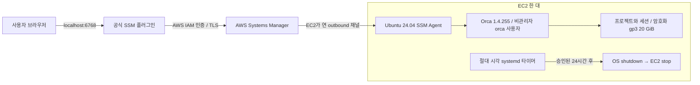

# 현재 배포 구조

서울 기본 VPC의 공용 서브넷을 재사용한다. 공인 IPv4는 패키지 다운로드와 SSM outbound 연결용이다. 보안 그룹 인바운드는 0개이며 SSH 키도 생성하지 않는다. Orca 1.4.255의 `pair`는 네트워크 노출을 요구하여 명시적 loopback bind에서는 `network_exposure_failed`로 거절했다. 따라서 최종 Orca 리스너는 0.0.0.0:6768이며 `--refuse-public`을 사용한다. AWS 보안 그룹에서 모든 인바운드를 차단하고, SSM Agent가 loopback으로 전달하는 경로로만 접속한다. `--pairing-address 127.0.0.1`은 SSM 로컬 포워딩 클라이언트에게 안내할 주소다.

원격 서버는 [Orca 공식 문서](https://www.onorca.dev/docs/remote-servers)에서 베타로 안내한다. 공인 포트를 직접 공개하지 않으며, 계정별 격리나 실시간 공동 편집을 지원한다고 주장하지 않는다.

SSM 터널은 계정의 권한 있는 사용자만 연결한다. 팀원 접속을 위해서는 별도 최소권한 IAM 접속 권한 또는 승인된 사설 네트워크 구성이 추가로 필요하다. 현재의 로컬 URL을 공개 인터넷 URL이라고 표현하지 않는다. 외부 포털과 HTTPS는 다음 구현 단계다.

## 다음 단계
FastAPI + HTML/CSS/JS + SQLite 운영 포털, 고정 대상 상태조회, 프로젝트·메모·운영 기록, 백업/실제 복원 검증. 현재 문서의 구성도에는 아직 구현하지 않은 요소를 배포 완료로 표시하지 않는다.
