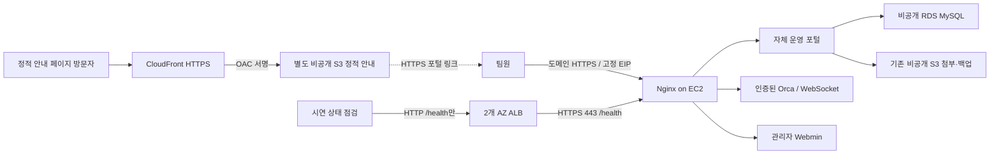

# 강의 전체 적용 시연 — 2026-11-11

## 실제 사용한 구성

EC2는 기존 1대만 사용한다. ALB가 두 AZ를 사용해도 앱 서버는 한 대여서 고가용성 구성으로 주장하지 않는다. CloudFront는 별도 정적 안내 페이지를 제공하며 포털 로그인·Orca WebSocket을 캐시하지 않는다. 안내에서 실제 HTTPS 포털로 이동한다. Route 53 유료 도메인/호스팅 영역 대신 사용자의 기존 무료 DNS를 사용했다. 이는 서비스 이름을 모두 생성했다는 주장이 아니라 강의의 도메인 연결 목적을 기존 제공자로 구현한 것이다.

## 실제 확인

- EIP 연결 대상이 기존 EC2와 일치. 사용자 DNS A 레코드도 해당 고정 IP로 변경됐고 정상 DNS로 HTTPS /health, 로그인, 프로젝트 조회와 Orca 연결 링크 발급 성공.
- ALB 대상은 처음 가용 영역 불일치로 unused였다. AWS 오류 설명과 EC2 AZ를 확인하고 ALB에 EC2가 있는 AZ를 포함한 뒤 healthy 및 /health 200 확인.
- ALB 전용 SG는 inbound TCP80, outbound 기존 EC2 SG TCP443만 허용한다. 제한 후 healthy를 재검증했다. ALB 기본 응답 404, /health만 대상 전달. /api/login 404. HTTP ALB는 운영 로그인 경로로 안내하지 않는다.
- CloudFront 상태 Deployed, HTTPS 안내 페이지 200. HTTP는 HTTPS로 전환한다. 별도 S3는 public access block 4개, AES256, 특정 distribution ARN의 cloudfront.amazonaws.com에만 GetObject 허용. 익명 원본 index.html 403.
- 공개 HTTPS Orca에서 기존 aws-teamproject 선택, 터미널 명령 실행 후 /tmp 고유 표식을 SSM에서 확인. README 소스 편집·저장 고유 표식이 EC2 파일에 있음을 확인하고, 변경 전체가 본인 표식임을 확인한 뒤 보존 원본과 바이트 단위로 복구했다. 기존 미커밋 변경은 보존했다.
- 실제 공개 WebSocket 연결 후 별도 시험 세션 로그아웃: 0.02초 뒤 1008 종료 확인. 기존 사용자 전체 세션을 회수한 시험은 아니다.

## 운영 기간과 정리

사용자는 추가 비용과 오늘 13:47 종료 후 시연 자원 정리를 승인했다. EC2/RDS 기존 종료 시각은 연장하지 않았다. 시연 ALB, target group, 전용 SG, CloudFront distribution/OAC, 별도 정적 S3의 index.html/버킷만 정리 대상으로 기록했다. CloudFront는 disable 배포가 완료된 후에야 삭제할 수 있어 정리에 전파 대기 시간이 필요하다. 기존 첨부·백업 버킷과 DB/EBS/EIP는 삭제하지 않는다.

생성·정리 대상 실제 ID와 원시 실행 결과는 Git 제외 .local/course-demo.json, course-cleanup.json에 보관한다. 원본 강의, 자격증명, 원시 계정 식별자는 공개하지 않는다. 재실행 시 기존 상태와 AWS 자원을 먼저 조회하고 중복 생성하지 않는다. 정리 완료 결과는 STATUS.md와 verification.md에 추가한다.

AI 로그인·실제 AI 작업·3인 동시 접속·실제 SMTP 알림·사용자 TOTP 등록은 미완료다. 기존 Orca 자체 기능과 자체 개발 포털 코드는 구분한다.

종료 보조 예약: AWS Scheduler의 일회성 작업으로 같은 시각에 새 ALB 삭제와 특정 CloudFront 배포 비활성화를 예약하고 enabled를 확인했다. 별도 임시 역할은 해당 자원에 필요한 두 동작만 허용하며 신뢰 정책에 짧은 시각 만료 조건을 뒀다. PC 정리 프로세스는 최종 CloudFront/OAC/정적 버킷과 ALB 전용 자원 삭제까지 추적한다.

## 최종 확인 — 2026-11-11 13:51 KST
- 승인된 종료 시각에 EC2 stopped 확인, RDS도 stopped 확인. 운영 시간을 연장하지 않았다. 현재 공개 포털/Orca/Webmin은 중지 상태다.
- EC2 중지 후에도 EIP 연결과 동일 주소가 유지됨을 AWS에서 확인했다. 중지 후 재시작 시험까지 추가 수행하지는 않았다.
- 시연 ALB, target group, 전용 SG, CloudFront distribution, OAC, 별도 정적 S3 버킷은 각각 명시적인 NotFound/404 응답으로 삭제 확인했다. 기존 RDS/EBS/첨부·백업 S3/EIP는 보존했다.
- 일회성 Scheduler 예약은 실행 후 모두 사라졌고, 이번에 만든 두 임시 Scheduler IAM 역할과 인라인 정책도 제거했다.
- RDS 자동 재시작 예정은 2026-11-18 13:50:51 KST로 조회됐다. 중지 상태에서도 저장 비용이 남으며, 재시작 이후에는 컴퓨팅 비용이 다시 발생한다. 최종 삭제나 운영 연장은 별도 결정이 필요하다.
- EIP는 중지 중에도 $0.005/시간(30일 약 $3.60)이 남는다. EBS/RDS 저장·기존 S3도 별도다. 최종 청구액이나 크레딧 잔액은 실시간 추정과 구분한다.
