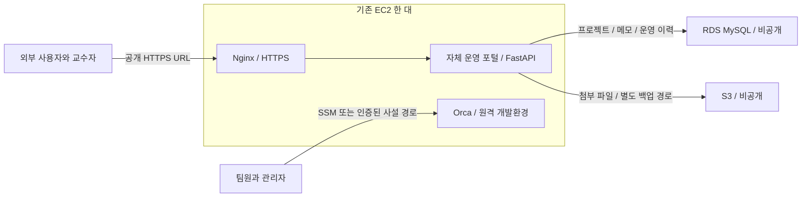

# 강의 자료 기준 재검토 보고서

## 2026-11-11 재검토 및 실제 반영

아래의 2026-11-10 검토는 구현 전 기록이다. 현재 상태는 이 절과 STATUS.md를 우선한다.

이전 검토에서 **2장 84–102쪽의 탄력적 IP(EIP) 실습을 빠뜨렸다.** 85쪽은 중지·시작 후 유지되는 고정 공인 IP를 설명하고, 93–102쪽은 할당·연결·확인 절차다. 현재 기존 EC2에 EIP 1개를 연결했으며 AWS 조회에서 연결 대상을 확인했다. 실제 주소와 할당 ID는 Git 제외 운영 설정에 보관한다. 기존 자동 할당 IP를 EIP로 전환할 수 없어 DNS A 레코드는 한 번 변경해야 한다. 중지 후 주소 유지는 AWS의 EIP 동작이며, 이번 시간 창에서 추가 중지·재시작 시험을 수행한 것은 아니다.

| 강의 | 현재 활용 및 검증 | 남은 범위 |
|---|---|---|
| 1장 AWS 시작 | 기존 리전·IAM 역할·크레딧/자원 확인 후 한 EC2 재사용 | 크레딧과 청구액은 지연 반영 |
| 2장 EC2 | 원격 Orca/포털, 서비스 자동 시작, EIP 실제 연결 | DNS A 레코드 변경 및 일반 HTTPS 접속 확인 |
| 3장 도메인 | 사용자가 관리하는 무료 도메인 A 레코드 + 유효한 TLS | Route 53 유료 호스팅 영역은 미생성, 기존 DNS 유지 |
| 4장 ELB | Nginx HTTPS 및 /health; 단일 서버 경로 | 승인 후 ALB 생성, HTTPS 대상 healthy 및 /health 200; 단일 EC2 고가용성 주장 안 함 |
| 5장 RDS | 비공개 MySQL, EC2 SG만 허용, 실제 DB 유지·앱 접속 | 새 RDS 스냅샷 복원은 미시험 |
| 6장 S3 | 비공개 첨부 업로드/다운로드, 역할 최소권한, 백업 | 강의의 공개 읽기 정책을 백업에 적용하지 않음 |
| 7장 정적 배포 | 포털 정적 자산은 현재 EC2 같은 출처; S3는 비공개 데이터용 | 승인 후 별도 비공개 S3/OAC/CloudFront 배포 및 200/원본 403 검증 |
| 8장 정리 | EC2/RDS별 서버 타이머와 클라우드 일회성 종료 예약 검증 | 저장/EIP 비용 잔존, 최종 삭제는 별도 승인 필요 |
| 최종 프로젝트 | 공개 HTTPS → 앱 → RDS/S3, 인증·상태·논리 복구 | AI 로그인·3인 동시 접속 미검증; 공개 Orca 편집·명령 실행 검증 |

최종 프로젝트 17쪽에는 ELB/CloudFront 생략 표시, 21–22쪽에는 Nginx/Certbot 경로가 있다. 초기에는 이 대안을 적용했다. 이후 사용자 추가 승인으로 ALB/CloudFront도 별도 시연 경로에 실제 배포했다. [시연 구성과 검증](course-demo.md)을 참고한다. 사용자가 요청한 강의 전체 활용에 맞춰 누락 항목을 확인하고, 새로운 유료 자원은 비용과 운영 기간을 먼저 확인한다.

EIP는 실행/중지와 관계없이 보유 중 $0.005/시간이다. 30일 $3.60, 730시간 $3.65이며 중지 후에도 남는다. [AWS EIP 문서](https://docs.aws.amazon.com/AWSEC2/latest/UserGuide/elastic-ip-addresses-eip.html), [VPC 가격](https://aws.amazon.com/vpc/pricing/).

검토일: 2026-11-10, Asia/Seoul. 이번 작업은 자료 검토와 가격 조회만 수행했다. AWS 자원·보안 그룹·접속 권한·자동 중지 예약은 변경하지 않았다.

## 1. 현재 주소에 대한 정정

`http://127.0.0.1:6768/`은 현재 PC의 루프백 주소다. 다른 사람이 자신의 PC에서 이 주소를 열면 자신의 PC에 연결한다.

현재 경로는 다음과 같다.

`현재 PC 브라우저 → 현재 PC의 SSM 포워딩 포트 → AWS SSM → EC2의 Orca`

Orca 프로그램과 프로젝트 파일은 실제 AWS EC2에 있고, 웹 편집·실행·재부팅 복구도 그 서버에서 검증했다. 그러나 일반 외부 사용자가 URL만 받아 접속할 수 있는 공개 서비스는 아직 없다. EC2에 공인 IPv4가 있다는 사실만으로 웹 서비스가 공개되는 것도 아니다. 현재 보안 그룹 인바운드가 0개여서 외부 직접 접근은 차단돼 있다.

이전 완료 보고는 **Orca 설치와 제한된 접속 경로의 동작 확인**을 뜻한다. 이를 강의 최종 프로젝트 수준의 웹 서비스 배포 완료로 평가하면 부족하다. 앞으로 공개 URL, 자체 애플리케이션, DB와 파일 저장소 연동, 외부 사용자 시나리오를 별도 완료 조건으로 둬야 한다.

## 2. 검토 방법과 자료 범위

제공된 PDF 9개, 총 912쪽의 텍스트를 추출해 관련 설명을 대조했다. 텍스트에 잡히지 않는 구성도·콘솔 화면은 관련 페이지를 이미지로 렌더링해 확인했다. 모든 912쪽을 동일한 깊이로 시각 검사했다는 뜻은 아니다. 원본 PDF는 수정하지 않았다.

페이지 번호는 PDF의 첫 페이지를 1쪽으로 센 번호다. 이번 첨부에는 별도의 과제 공지 PPT 원본이 없다. 이전 인계의 공지 요약은 참고했지만, 원문을 새로 읽었다고 간주하지 않는다. 강의 예제의 구현 방식과 과제의 강제 채점 조건은 구분한다.

| 자료 | 분량 | 확인한 근거와 이번 프로젝트에 주는 의미 |
|---|---:|---|
| **1장 AWS 시작하기** (강의 자료, 저장소 미포함) | 131쪽 | 82–89쪽은 EC2·Route 53·ELB·RDS·S3·CloudFront를 수업 서비스로 소개. 서비스 목록만으로 전부 과제 필수라고 단정할 수 없음. 100쪽의 12개월 무료 설명은 현재 계정의 실제 Free plan/크레딧 조회 결과와 구분해야 함. |
| **2장 EC2로 백엔드 서버 배포하기** (강의 자료, 저장소 미포함) | 142쪽 | 51쪽은 HTTP 인바운드 허용, 75쪽은 퍼블릭 IPv4, 113쪽은 EC2 퍼블릭 IP로 브라우저 접속을 확인. 현재 localhost+SSM만으로는 이 외부 접속 시나리오를 충족하지 못함. 113쪽의 샘플 404 응답은 서버 응답 확인용이며 완성된 앱 기능 검증과는 다름. |
| **3장 Route 53으로 도메인 주소 연결하기** (강의 자료, 저장소 미포함) | 57쪽 | 12쪽에 본 과정에서는 유료 도메인을 구입하지 않는다고 명시. 34–42쪽은 무료 도메인 또는 퍼블릭 IP 연결 실습. Route 53 유료 구매가 공개 접속의 필수 조건은 아님. 무료 서비스의 현재 발급·DNS 제어 가능성은 따로 확인해야 함. |
| **4장 ELB로 안전한 백엔드 서버 만들기** (강의 자료, 저장소 미포함) | 120쪽 | 20쪽은 listener/target group/health check, 44쪽은 internet-facing ALB, 53–60쪽은 /health 검증. 84쪽은 AWS가 부여한 elb.amazonaws.com 이름에 일반 ACM 인증서를 발급하는 방식의 한계를 설명. ALB가 없어도 공개 웹 서비스를 구성할 수 있으며, 단일 EC2에 ALB만 추가해 애플리케이션 고가용성을 확보했다고 말하면 안 됨. |
| **5장 RDS로 데이터베이스 손쉽게 만들기** (강의 자료, 저장소 미포함) | 109쪽 | 2–3쪽은 관리형 DB 및 연산·저장 분리, 25–26쪽은 RDS의 목적, 89–92쪽은 백엔드 연결과 외부 요청 확인. SQLite는 관계형 DB라는 점에서는 설명 가능하지만, 이 RDS 활용 내용 자체를 재현하지는 못함. |
| **6장 S3로 이미지 저장소 만들기** (강의 자료, 저장소 미포함) | 131쪽 | 3–6쪽은 객체 스토리지, 111–115쪽은 API 요청 → 게시글/이미지 저장 → S3 객체와 조회 결과 검증. 단순히 버킷을 만드는 데서 끝내지 않고 앱에서 사용해야 함. 예제의 공개 읽기 정책을 프로젝트 백업·설정 파일에 그대로 적용하면 안 됨. |
| **7장 S3와 CloudFront로 웹 사이트 배포하기** (강의 자료, 저장소 미포함) | 117쪽 | 5–7쪽은 정적 호스팅/CDN, 69쪽은 OAC, 85쪽은 CloudFront 기본 배포 도메인으로 접속, 86쪽은 자체 도메인 인증 실습 생략 안내. S3는 정적 파일용이므로 Orca·FastAPI 프로세스나 DB를 대신 실행할 수 없음. |
| **8장 AWS 자원 깔끔하게 삭제하기** (강의 자료, 저장소 미포함) | 44쪽 | 2쪽은 stop과 terminate의 차이, 13–30쪽은 자원별 정리, 34쪽은 월간 유지비 비교, 43쪽은 예산 알림. EC2 자동 중지 예약이 다른 RDS·ALB·S3까지 정리하거나 비용을 모두 없애는 것은 아님. 삭제 절차는 참고 자료이며 이번 사용자 요청에서 삭제를 승인한 것으로 취급하지 않음. |
| **최종 프로젝트: 게시판 웹 서비스 배포하기** (강의 자료, 저장소 미포함) | 61쪽 | 3쪽은 AWS 백엔드 주소로 실제 요청·응답, 10쪽은 RDS+S3 기능, 17–22쪽은 구성도/EC2·RDS·S3/직접 Nginx·Certbot 경로, 32쪽은 도메인·HTTPS 일부 선택 사항, 39·44쪽은 외부 브라우저 및 E2E, 45–49쪽은 S3 프런트 배포. 현재 Orca 설치만으로 이 통합 결과가 완성되지는 않음. |

## 3. 최종 프로젝트 PDF에서 중요한 예외

텍스트만 추출하면 놓치는 내용이 있다.

- **17쪽:** 아키텍처 그림에서 CloudFront와 ELB 아이콘에 빨간 X가 그려져 있다.
- **18쪽:** 일반 구성 설명은 여전히 CloudFront/ELB를 포함한다. 즉 문서 안에 원래 구성 설명과 수업용 수정 표시가 함께 있다.
- **19쪽:** EC2에서 RDS와 S3를 연결하고, RDS는 외부 접근을 막아 EC2 보안 그룹에서만 접근하도록 하는 그림이다.
- **21–22쪽:** EC2 앞에서 Nginx를 구동하고 Certbot으로 HTTPS를 적용하는 경로를 별도로 제시한다.
- **24쪽:** 실습에서는 SSL 미적용이라는 주석이 있다.
- **32쪽:** 도메인 연결과 HTTPS listener 설정에 선택 사항 표시가 있다.
- **37쪽:** 초기 S3 공개 읽기 실습과, 이후 OAC로 S3를 비공개로 바꾸는 보완 방법을 함께 제시한다.
- **52쪽:** HTTP 실습 예외를 설명하지만, 일부 HTTPS 설명은 일반적인 웹의 기술적 필수 조건과 동일하지 않다. 공개 로그인 서비스의 보안 기준을 이 예외에 맞춰 낮추지는 않는 편이 적절하다.

판단: 이 자료만으로 ALB·CloudFront·유료 Route 53을 모두 과제 필수라고 볼 근거는 부족하다. 특히 17쪽 X 표시는 ALB/CloudFront를 생략하는 수업용 구성을 시사한다. 다만 이것을 교수자의 명시적인 채점 면제 지시와 동일하게 단정하지는 않는다. **외부 브라우저 접근과 애플리케이션·RDS·S3의 실제 연동이 더 일관되게 반복되는 목표다.**

## 4. 현재 구성과의 차이

| 항목 | 현재 검증 상태 | 보완 필요 |
|---|---|---|
| EC2 한 대 | 실제 생성·운영·재부팅 확인 | 기존 서버 재사용 가능. 중복 EC2 불필요 |
| Orca 설치/웹 편집·실행 | 확인 | 기존 성과로 유지. 자체 개발 코드로 주장하지 않음 |
| URL만으로 외부 접속 | 없음 | 교수자/팀원이 AWS CLI·SSM 설치 없이 접속할 공개 서비스 URL 필요 |
| 자체 포털·API | 미구현 | 프로젝트·작업 메모·운영 이력·상태조회 등 사용자 기능 구현 |
| DB | SQLite 제안만 있고 앱 DB 미구현 | 강의 반영을 우선하면 RDS MySQL 권고. 저비용 대체안을 택한다면 수업 요구를 생략해도 되는지 확인 필요 |
| S3 | 미생성 | 앱의 첨부 파일 또는 시연 자료 저장과 실제 업로드/조회, 별도 비공개 백업 경로 |
| 프런트 배포 | Orca 자체 웹 번들만 있음 | 자체 포털 프런트 배포 필요. S3 정적 배포는 수업 반영을 높이는 선택지 |
| HTTPS | 공개 서비스 없음 | 공개 로그인/개인 데이터는 유효한 HTTPS로 제공 |
| 모니터링·백업·복구 | Orca 서비스/재부팅 일부 점검만 확인 | 포털/API의 정기 점검, 기록, DB/파일 백업과 복원 검증 미완료 |
| 실제 AI 작업 | 사용자 요청으로 로그인 보류 | 로그인 후 실제 작업과 결과 증거 별도 필요 |
| 3인 접속 | 미검증 | 사용자별 접속·권한 및 동시 사용 측정 필요 |

## 5. 권고 구성: 공개 운영 서비스와 Orca 접속을 각각 완성

수업 내용을 반영하면서 현재 EC2를 재사용하는 안이다. **새 배포를 승인받은 상태나 구현 완료 상태가 아닌 권고안**이다.

- **포털 공개:** 사용자는 공개 HTTPS URL로 접속하고 포털 계정으로 인증한다. 프로젝트 등록, 메모 작성, 저장 데이터 재조회, 상태/백업 이력을 실제로 사용할 수 있어야 한다. EC2 보안 그룹에는 최종 웹 진입 경로에 필요한 규칙만 추가한다.
- **DB:** RDS는 별도 AWS 관리형 DB이므로 사용자가 운영하는 EC2 인스턴스는 한 대로 유지할 수 있다. RDS의 공개 접근은 끄고, 3306은 포털 EC2의 보안 그룹에서만 허용한다. 포털은 최소권한 DB 계정을 사용한다. Orca 내부 DB를 RDS로 이전하거나 포털에서 직접 수정하지 않는다.
- **S3:** 첨부 파일과 백업을 공개 읽기 대상과 섞지 않는다. 기본 비공개로 두고 서버 권한 또는 짧은 유효기간의 presigned URL로 필요한 객체만 제공한다. EC2에 장기 액세스 키를 복사하는 대신 지정 버킷/경로에 제한된 IAM 역할 권한을 사용한다. 현재 SSM 역할은 S3 접근 권한을 갖춘 상태가 아니므로 추후 최소권한 정책 설계가 필요하다.
- **프런트엔드:** 초기에는 EC2에서 포털 HTML을 같은 출처로 제공하면 CORS와 배포 복잡도를 줄일 수 있다. 이것은 7장 S3 정적 프런트 배포를 생략하는 절충이다. 강의의 프런트 배포까지 재현하려면 포털 정적 파일을 별도 S3로 옮기고 CloudFront/OAC를 검토한다. 백엔드 API도 유효한 HTTPS 경로가 있어야 하며, 정적 페이지에 HTTPS만 붙인 것으로 API의 보안까지 끝나는 것은 아니다.
- **도메인:** Route 53에서 새 도메인을 구매할 필요는 없다. 기존/무료 서브도메인을 사용할 수 있다면 DNS 제어와 인증서 발급 가능 여부를 먼저 확인한다. HTTP 공인 IP는 공개 접속 점검용으로 쓸 수 있어도 실제 로그인 정보를 전송하는 최종 경로로 사용하지 않는다.
- **ALB:** 기본안에서 추가하지 않는 것을 권한다. EC2 한 대에서는 다중 앱 서버 장애 대체 효과가 없고 고정 비용이 생긴다. ALB 실습 자체가 필요하면 한 EC2를 target으로 연결하는 별도 시연은 가능하지만, 전체 서비스 고가용성 확보로 설명하면 안 된다.
- **Orca:** [공식 원격 서버 문서](https://www.onorca.dev/docs/remote-servers)는 베타이며 공인 포트 직접 공개를 권하지 않는다. 포털을 공개하는 것과 Orca를 터널 없이 공개 URL로 쓰는 것은 별개의 작업이다. **원하는 결과가 Orca 자체의 공유 웹 URL이라면**, 인증 게이트웨이/인증된 터널과 WebSocket·페어링·권한 검증을 추가해야 한다. 현재는 그 경로가 구현되지 않았다. 단순히 6768 포트를 열어서 해결한 것으로 처리하지 않는다.

참고: [RDS 비공개 DB 권장 구성](https://docs.aws.amazon.com/AmazonRDS/latest/UserGuide/CHAP_GettingStarted.CreatingConnecting.MySQL.html), [EC2 IAM 역할과 최소권한](https://docs.aws.amazon.com/AWSEC2/latest/UserGuide/iam-roles-for-amazon-ec2.html), [CloudFront OAC](https://docs.aws.amazon.com/AmazonCloudFront/latest/DeveloperGuide/private-content-restricting-access-to-s3.html).

### 비용 우선 대안

EC2 + Nginx + FastAPI + SQLite + S3로도 공개 포털은 기술적으로 만들 수 있다. 기존 설계는 이 비용 절감을 의도했다. 다만 RDS의 관리형 DB·컴퓨팅/저장 분리·연결 보안이라는 수업 내용을 실제 적용한 결과가 사라진다. 따라서 현 자료를 새로 검토한 뒤에는 **RDS 포함안을 우선 권고**한다. 이를 확정 필수 또는 교수자가 승인한 설계라고 표현하지 않는다.

## 6. 비용 재검토

2026-11-10 AWS Price List API 읽기 전용 조회, 서울 리전, 정가 기준. 실제 배포 자원의 견적 확정이나 추가 지출 승인이 아니다. 월 환산은 730시간이다.

| 구성 | 계산 | 비용 |
|---|---|---:|
| 기존 t3.small + 공인 IPv4 1개 + 20 GiB gp3 | 이전 확인된 단가 | 약 $24.45/월 |
| RDS MySQL db.t4g.micro Single-AZ 컴퓨팅 | $0.025 × 730 | 추가 $18.25/월 |
| 두 항목 소계 | EC2 구성 + RDS 컴퓨팅 | **약 $42.70/월 + RDS 저장장치·S3·트래픽 등** |
| 선택 ALB 자체 | $0.0225 × 730 | 추가 $16.43/월 |
| 선택 ALB의 2개 AZ 공인 IPv4 가정 | 2 × $0.005 × 730 | 추가 $7.30/월 |
| 선택 ALB 고정 부분 소계 | 위 두 항목 | 추가 약 $23.73/월 + 실제 LCU·트래픽 |

LCU 단가도 $0.008/LCU-hour로 조회했다. Outposts, trust store, reserved capacity 등 다른 상품의 단가와 구분했다. 실제 사용량이 없는 LCU를 월 1개 사용한다고 임의 가정하지 않았다. 위 RDS 계산은 인스턴스 컴퓨팅만이며, 20 GiB 스토리지 등을 포함한 최종 가격은 생성 설정이 정해진 뒤 다시 계산해야 한다. 해당 클래스/엔진 버전의 실제 Free plan 생성 가능성과 계정 제한도 생성 전에 확인해야 한다.

이번 세션 직전 확인한 잔여 크레딧 비공개 로컬 비용 기록 참조를 무제한 무료라고 해석하면 안 된다. ALB까지 항상 켜면 이 크레딧을 빠르게 소모하므로 우선순위가 낮다. [ELB 공식 가격](https://aws.amazon.com/elasticloadbalancing/pricing/)은 공인 IPv4 별도 과금을 안내한다. [VPC 공식 가격](https://aws.amazon.com/vpc/pricing/)도 함께 확인했다.

현재 승인된 것은 **기존 EC2의 초기 24시간 운영**이다. 종료 예약은 승인된 시각(로컬 배포 설정 참조)다. RDS나 ALB를 추가할 경우 기존 EC2의 shutdown 타이머가 이 자원까지 멈추지 않는다. 별도 운영 기간과 정리 방법을 정해야 한다. RDS도 [중지 중 스토리지 과금이 남고 최대 7일 중지 제한](https://docs.aws.amazon.com/AmazonRDS/latest/UserGuide/USER_StopInstance.html)이 있다. 이번 검토 중 자원을 삭제하거나 플랜을 전환하지 않았다.

## 7. 다음 구현의 완료 기준

1. 다른 PC 또는 휴대전화 모바일 데이터에서 SSM 없이 공개 포털 URL 접속.
2. 정상 HTTPS 인증서와 로그인 성공/실패, 비인가 API 요청 거부 확인.
3. 프로젝트·메모 등록 → RDS 실제 저장 → 브라우저 재접속 후 조회 확인.
4. 앱에서 파일 업로드 → S3 객체 존재 → 허용된 사용자 다운로드 확인. 비공개 백업의 익명 접근 거부도 확인.
5. Orca 서비스 중단을 포털에서 감지하고 복구 상태를 기록. 임의 셸 실행 웹 API는 만들지 않음.
6. 포털 DB·프로젝트 시험 파일을 백업하고, 별도 복원 시험에서 실제 내용 비교.
7. EC2 재부팅 후 포털·Orca 자동 시작, RDS 데이터 유지, 브라우저 재접속 확인.
8. 사용자가 AI 로그인을 진행하기로 하면 서버에서 새 인증 후 실제 에이전트 작업 검증. 현재 보류 결정을 유지.
9. 팀원 3명 접속과 권한/자원 사용을 실제로 측정. 단일 공유 런타임을 완전한 사용자 격리로 표현하지 않음.

이번 검토 결과는 **현재 배포를 폐기할 이유가 생겼다는 뜻이 아니라, EC2/Orca 기반 위에 공개 서비스와 수업의 DB·스토리지 연동을 더 완성해야 한다는 판단**이다. 수정할 우선순위는 공개 접속 경로와 자체 애플리케이션, RDS·S3 연동, 운영·복구 검증 순서다.
