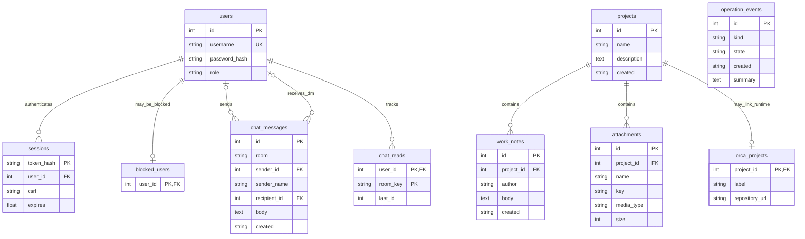

# 포털 데이터 모델

팀 공동 포털이므로 로그인한 팀원끼리 프로젝트·메모·첨부를 공유한다. 사용자별 비공개 프로젝트 격리는 구현 범위에 없다. 모든 SQL 값은 ORM/파라미터로 전달한다.
Orca의 내부 데이터베이스와 AI 자격증명은 이 DB에 포함하지 않는다.

## 팀 채팅 (2026-11-11 추가)
- `chat_messages.room`이 `main`이면 전체 채팅, `dm`이면 `sender_id`↔`recipient_id` 1:1 대화다. `sender_name`을 함께 저장해 계정이 삭제돼도 전체 채팅 기록은 이름으로 남는다(`sender_id`는 NULL). 삭제된 계정의 1:1 대화와 읽음 기록은 지운다.
- `chat_reads`는 사용자별·방별 마지막으로 읽은 메시지 id다. 읽지 않은 수 = 그 id보다 큰 상대 메시지 수.
- 브라우저는 3초마다 `/api/changes`(최대 id·개수 지문)를 확인하고 바뀐 부분만 다시 불러온다. 별도 WebSocket 서버나 Nginx 설정 변경이 없다.
- 조회 전용(게스트) 계정도 채팅은 쓸 수 있다. 프로젝트·메모·첨부 쓰기는 계속 거절한다. 한 사용자당 10초에 20개를 넘는 메시지는 429로 거절한다.
- 업무 데이터 논리 백업 범위에는 채팅이 포함되지 않는다.

## 2026-11-12 추가 테이블
- `attachment_owners(attachment_id PK·FK, uploaded_by, uploaded_at)` — 첨부 삭제 권한 판단. 이전 첨부는 행이 없어 관리자만 삭제.
- `chat_edits(message_id PK·FK, edited_at, deleted)` — 채팅 수정·삭제 표시. 삭제 시 본문은 비운다.
- `project_access(project_id PK·FK, group_id PK·FK)` — 행이 있으면 해당 그룹 멤버와 관리자만 프로젝트를 본다.
- 2026-11-11 추가: `team_groups`, `group_members`, `user_activity`, `project_archives`, `note_edits`, `orca_link_requests`. 모두 기존 테이블을 `ALTER`하지 않는 별도 테이블이다.
