# 포털 데이터 모델 — 2026-11-12 개선안

현재 로컬 모델은 39개 테이블이다. 운영 배포는 이전 35개 테이블 기준이며 아래 추가 기능은 미배포다. 배포 여부는 STATUS.md의 최신 검증 기록을 따른다. 기존 8개 테이블 설명은 현재 전체 스키마가 아니다.

## 관계 개요

```mermaid
erDiagram
    projects ||--o{ attachments : references
    users ||--o{ blocked_users : references
    users ||--o{ chat_messages : references
    users ||--o{ chat_messages : references
    users ||--o{ chat_reads : references
    users ||--o{ group_members : references
    team_groups ||--o{ group_members : references
    projects ||--o{ orca_link_requests : references
    projects ||--o{ orca_projects : references
    users ||--o{ profiles : references
    team_groups ||--o{ project_access : references
    projects ||--o{ project_access : references
    projects ||--o{ project_archives : references
    users ||--o{ sessions : references
    projects ||--o{ tasks : references
    users ||--o{ user_activity : references
    users ||--o{ user_totp : references
    projects ||--o{ work_notes : references
    attachments ||--o{ attachment_owners : references
    chat_messages ||--o{ chat_attachments : references
    chat_messages ||--o{ chat_edits : references
    chat_messages ||--o{ chat_pins : references
    users ||--o{ chat_reactions : references
    chat_messages ||--o{ chat_reactions : references
    chat_messages ||--o{ chat_replies : references
    chat_messages ||--o{ chat_replies : references
    work_notes ||--o{ note_edits : references
```

## 테이블과 컬럼

| 테이블 | 컬럼 |
|---|---|
| `change_notices` | `id` PK, `project_id`, `kind`, `title`, `body`, `actor`, `admin_only`, `created` |
| `notice_reads` | `user_id` PK, `last_id` |
| `object_deletions` | `key` PK, `created`, `attempts` |
| `operation_events` | `id` PK, `kind`, `state`, `created`, `summary` |
| `project_policies` | `project_id` PK, `restricted` |
| `projects` | `id` PK, `name`, `description`, `created` |
| `recovery_codes` | `user_id` PK, `code_hash` PK |
| `session_activity` | `token_hash` PK, `last_active` |
| `team_groups` | `id` PK, `name`, `description`, `created` |
| `totp_vault` | `user_id` PK, `encrypted` |
| `upload_records` | `key` PK, `username`, `scope`, `size`, `created` |
| `user_preferences` | `user_id` PK, `notify`, `sound` |
| `users` | `id` PK, `username`, `password_hash`, `role` |
| `attachments` | `id` PK, `project_id` FK, `name`, `key`, `media_type`, `size` |
| `blocked_users` | `user_id` PK FK |
| `chat_messages` | `id` PK, `room`, `sender_id` FK, `sender_name`, `recipient_id` FK, `body`, `created` |
| `chat_reads` | `user_id` PK FK, `room_key` PK, `last_id` |
| `group_members` | `group_id` PK FK, `user_id` PK FK |
| `orca_link_requests` | `id` PK, `project_id` FK, `repository_url`, `folder`, `state`, `detail`, `requested_by`, `created`, `finished` |
| `orca_projects` | `project_id` PK FK, `label`, `repository_url` |
| `profiles` | `user_id` PK FK, `display_name`, `team`, `photo_key`, `updated` |
| `project_access` | `project_id` PK FK, `group_id` PK FK |
| `project_archives` | `project_id` PK FK, `archived_by`, `archived_at` |
| `sessions` | `token_hash` PK, `user_id` FK, `csrf`, `expires` |
| `tasks` | `id` PK, `project_id` FK, `title`, `status`, `assignee`, `due`, `created_by`, `created`, `updated` |
| `user_activity` | `user_id` PK FK, `last_login`, `last_seen`, `must_change` |
| `user_totp` | `user_id` PK FK, `secret`, `enabled`, `created` |
| `work_notes` | `id` PK, `project_id` FK, `author`, `body`, `created` |
| `attachment_owners` | `attachment_id` PK FK, `uploaded_by`, `uploaded_at` |
| `chat_attachments` | `message_id` PK FK, `key`, `name`, `media_type`, `size` |
| `chat_edits` | `message_id` PK FK, `edited_at`, `deleted` |
| `chat_pins` | `room_key` PK, `message_id` FK, `pinned_by`, `pinned_at` |
| `chat_reactions` | `message_id` PK FK, `user_id` PK FK, `emoji` PK, `created` |
| `chat_replies` | `message_id` PK FK, `reply_to` FK |
| `note_edits` | `note_id` PK FK, `edited_by`, `edited_at` |

## 별도 보안·정책 메타데이터

`project_policies`는 허용 그룹이 없어져도 제한 공개를 보존한다. `session_activity`는 세션별 유휴 활동 시각을 보관한다. `totp_vault`는 암호화 시드, `recovery_codes`는 일회용 복구 코드의 해시다. 이 별도 메타데이터의 관계 일부는 애플리케이션이 관리하며 위 FK 도식에 없는 관계를 DB 제약이라고 주장하지 않는다.

`upload_records`는 활성 파일 용량을 집계하고 `object_deletions`는 실패한 실제 파일 삭제를 재시도한다. `change_notices`와 `notice_reads`는 다음 접속에도 남는 변경 내역과 계정별 확인 위치를 보관한다.

Orca 내부 DB·AI 자격증명은 이 모델에 포함하지 않는다. 프로젝트 공개 범위는 포털 자료의 권한이며 공유 Orca 계정의 서버 파일 격리를 의미하지 않는다. 백업 v3의 범위와 제외 항목은 [보안·운영 개선](review-hardening.md)을 따른다.

## 소유권·저장소 추가 메타데이터 (2026-11-14)

`project_owners`는 프로젝트당 소유자 1명을 기록한다. `project_repositories`는 정규화 GitHub URL·예약 폴더·revision을 기록한다. `project_deploy_keys`는 세대·공개키·지문·상태만 기록한다. `project_jobs`는 고정된 네 작업(link/key_create/key_verify/key_remove)의 대기·실행·실패/완료 상태를 기록한다. 프로젝트 삭제 후 키 정리 작업이 살아남도록 작업 테이블의 project_id/actor_id는 의도적으로 FK가 아니다. 기존 테이블을 바꾸지 않는다. 백업 v4와 권한 경계는 [소유권 안내](project-ownership.md)를 따른다.
