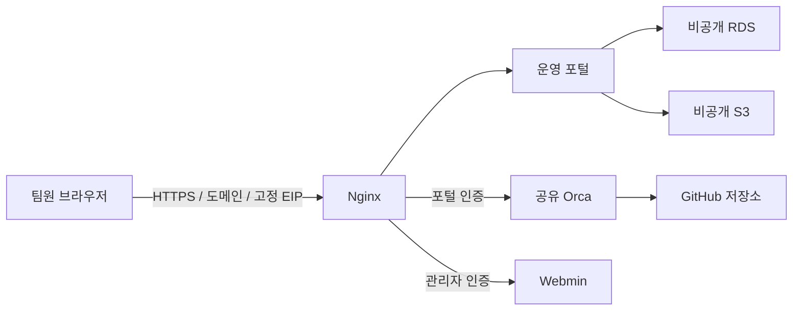

# 프로그램 구성과 사용 안내

이 프로젝트는 **AWS 기반 팀 공유 AI 개발환경 구축 및 운영** 과제다. 기존 Orca를 원격 개발 도구로 배포하고, 팀이 사용할 운영 포털과 API·데이터 관리·점검·백업/복구 기능을 직접 구현했다. 현재 운영 창과 종료 시각은 [STATUS.md](../STATUS.md)를 확인한다.

## 각 프로그램의 역할

| 구성 | 하는 일 | 사용하는 사람 |
|---|---|---|
| 운영 포털 | 로그인, 프로젝트·메모·첨부 공유, 점검·백업 이력 조회 | 관리자·팀원·조회 전용 사용자 |
| Orca | 실제 서버 파일 편집·저장과 터미널 실행, 추후 AI 도구 사용 | 관리자·팀원 |
| Webmin | 서버 서비스와 로그 확인 | 별도 관리 계정을 가진 관리자 |
| RDS MySQL | 포털 계정·세션·프로젝트·메모·첨부 메타데이터·운영 이력 저장 | 포털 서버가 비공개 연결 |
| 비공개 S3 | 첨부 파일 본문과 백업 객체 저장 | 서버 역할과 인증된 포털 경유 |
| GitHub | 소스 협업·버전 관리·자동 테스트 | 저장소 권한이 있는 팀원 |

Nginx·포털·Orca·Webmin은 기존 EC2 한 대에 있다. RDS와 S3는 AWS 관리형 서비스다. 강의 시연용 ALB/CloudFront/별도 정적 S3는 실제 검증 후 삭제했으며 현재 핵심 포털 경로에 포함되지 않는다.

## 추가 기능 (2026-11-12)
- **카카오톡식 전송 상태:** 보낸 말풍선은 '전송 중'으로 바로 보이고, 실패하면 빨간 '전송 실패'와 **재전송·삭제** 버튼이 나온다. 말풍선 옆 노란 숫자는 아직 읽지 않은 사람 수이며, 상대가 읽으면 바로 줄어든다.
- **다크·라이트 모드:** 위쪽 버튼이나 내 계정 → 화면 테마에서 고른다. 브라우저에 저장된다.
- **Orca AI 도구:** 서버 Orca 사용자에 Codex CLI 0.167.0과 Claude Code 2.1.322가 설치되어 있다. 로그인은 각 사용자가 Orca 터미널에서 `orca-ide account add --agent codex` / `--agent claude`로 직접 한다(토큰 복사 금지).
- **채팅 즉시 표시:** 브라우저가 서버에 요청 하나를 열어 두고, 누군가 쓰면 서버가 바로 응답한다(롱 폴링). 로컬 측정에서 메시지 생성 후 약 0.5초 안에 다른 사람 화면에 알림이 떴다. 포털이 프로세스 하나(`--workers 1`)로 도는 것을 전제로 한다.
- **채팅 알람:** 보고 있지 않은 방에 새 메시지가 오면 오른쪽 아래 팝업(누가·어느 방)과 짧은 소리. 팝업을 누르면 그 방이 열린다. 내 계정에서 팝업·소리를 따로 켜고 끈다.
- **한 아이디 한 곳 접속:** 같은 아이디로 새로 로그인하면 이전 접속(열린 Orca 연결 포함)이 끊기고, 끊긴 화면에 '다른 곳에서 로그인' 안내가 뜬다.
- **첨부 파일 삭제:** 올린 사람이나 관리자가 삭제한다. 포털 목록과 다운로드에서 사라진다. 현재 EC2 역할에 S3 삭제 권한이 없으면 S3 객체는 남을 수 있다(권한 추가는 별도 승인).
- **채팅 수정·삭제:** 보낸 사람은 수정·삭제, 관리자는 삭제만 한다. 삭제된 메시지는 "삭제된 메시지입니다"로 표시되고 다른 사람 화면에도 반영된다.
- **브라우저 알림:** 내 계정에서 켠다. 메시지 내용은 알림에 표시하지 않는다.
- **활동 기록(관리자):** 계정·권한, 콘텐츠 삭제, Orca 연결·접속 기록을 종류와 검색어로 본다. 일반 멤버의 점검 이력에는 관리 기록이 보이지 않는다.
- **프로젝트 공개 범위(관리자):** 그룹을 지정하면 그 그룹과 관리자만 프로젝트·메모·첨부·Orca 버튼을 본다. 다른 사람에게는 프로젝트가 없는 것처럼(404) 보인다. Orca 서버 런타임은 공유이므로 폴더 단위 격리를 뜻하지 않는다.
- **모바일:** 375px 폭에서 모든 화면이 가로로 넘치지 않고, 왼쪽 메뉴는 위쪽 가로 메뉴로 바뀐다.

## 새 기능 (2026-11-11)
- **실시간 갱신:** 다른 사람이 프로젝트·메모·첨부를 남기면 약 3초 안에 화면에 나타난다. 새로고침할 필요가 없다. 탭이 뒤에 있으면 15초마다 확인한다.
- **팀 채팅:** 화면 위쪽 **팀 채팅**에서 `# 전체 채팅`(모든 멤버)과 왼쪽 목록의 사람을 눌러 1:1 대화를 한다. 빨간 숫자는 읽지 않은 메시지, ●는 지금 접속 중이다. 메시지는 2000자까지, Enter로 보낸다.
- **내 비밀번호 변경:** 현재 비밀번호와 새 비밀번호를 넣는다. 다른 기기의 로그인은 끊기고 지금 기기는 유지된다.
- **멤버 관리(관리자):** 전체·접속 중·차단 수 요약, 아이디 검색, 역할·상태 필터, 15명씩 페이지. 각 줄에서 역할·접속 허용 적용, 비밀번호 재설정, 계정 삭제를 한다. 자기 계정과 마지막 관리자는 잠그거나 지울 수 없다. 삭제하면 1:1 대화는 지워지고 메모·전체 채팅 글은 이름으로 남는다.

## 사용 순서

1. 운영자가 전달한 HTTPS 포털 주소로 로그인한다. GitHub 로그인과 포털 계정은 별개다.
2. **프로젝트**는 포털에서 작업을 묶는 단위다. 이름과 설명을 등록하고, **작업 메모**에서 대상 프로젝트를 선택해 진행 상황을 남긴다.
3. **첨부 파일**에서 프로젝트와 작은 파일을 선택해 올린다. TXT/PNG/JPG/PDF, 파일당 1MiB까지다. 다운로드는 포털 로그인이 필요하다.
4. **Orca에서 개발환경 열기** 버튼이 있는 프로젝트를 누른다. 열린 Orca 사이드바에서 `aws-teamproject`를 선택해 파일과 터미널을 사용한다. 실제 프로젝트 코드는 서버에 있고, 브라우저에서 원격으로 조작한다.
5. 관리자만 **팀 계정·접속 회수**에서 팀원 또는 조회 전용 계정을 만든다. 초기 비밀번호는 길이 제한 없이 비어 있지만 않으면 된다(팀 요청으로 14자 조건 제거). 역할·접속 허용을 변경하면 대상의 기존 세션을 회수한다. 자신의 관리자 권한을 없애거나 마지막 관리자를 잠그는 동작은 거절한다.
6. 관리자는 **서버 관리 → Webmin**에서 별도 Webmin 계정으로 로그인해 서비스·로그를 확인한다. 포털 비밀번호와 동일하다고 가정하지 않는다.
7. 화면 맨 아래 **점검·백업 이력**은 기본 최근 3개를 한 줄 요약으로 보여준다. **이력 펼치기**를 누르면 조회된 최근 최대 100개를 상세히 보고 내부 스크롤할 수 있다. 다시 접을 수 있고 정기 새로고침에도 현재 펼침 상태를 유지한다.

### 프로젝트 추가와 Orca 프로젝트 추가의 차이

포털에 프로젝트를 추가한다고 Git 저장소나 Orca 작업 폴더를 자동 생성하지 않는다. 운영자가 Orca 연결 매핑을 등록한 포털 프로젝트에만 연결 버튼이 표시된다. 새 프로젝트에 버튼이 없어도 저장 실패가 아니다. 현재 버튼은 공유 Orca를 열며 특정 프로젝트를 자동 선택하거나 프로젝트별 파일 권한을 격리하지 않는다.

### GitHub에서 함께 작업하기

Orca의 터미널과 Git 기능으로 저장소·브랜치·변경 내용을 확인한다. 개인 작업은 별도 브랜치 또는 작업 트리로 나누고, 변경 내용을 검토한 뒤 커밋·push·PR로 협업한다. 서로의 미커밋 파일을 덮어쓰지 않는다. 현재 PC의 GitHub push 성공과 서버의 GitHub 쓰기 인증 완료는 별개다. 서버에는 공개 clone/fetch를 사용했고 쓰기 인증은 아직 미구성이다. PC의 토큰을 서버로 복사하지 않는다.

## 점검·백업은 어떻게 동작하나

- 점검은 약 1분마다 Orca TCP·디스크를 확인하고 가능한 경우 CPU/RAM을 기록한다. 이것이 실제 AI 요청 성공을 증명하지는 않는다. 점검 실패와 오래된 결과는 각각 실패·지연으로 표시한다.
- 서버가 실행 중일 때 논리 백업 타이머는 매일 UTC 00:00(한국 09:00)을 기준으로 동작한다. 중지 중에는 실행하지 못하며 Persistent 타이머가 재기동 시 놓친 실행을 처리할 수 있다.
- 업무 데이터 백업은 프로젝트·메모·첨부와 파일 내용을 담는다. 계정·세션·서버 전체 이미지의 백업이 아니다. 코드 백업은 별도 Git HEAD 스냅샷 기능이다.
- 이력 화면은 조회 화면이다. 웹 입력으로 서버 명령을 실행하거나 운영 DB를 복구하는 버튼은 제공하지 않는다. 수동 백업·별도 복원은 운영자가 승인된 관리 경로에서 진행한다.
- 모니터링 기록과 S3 백업의 보관 정책은 3일이다. 과거 전체 기록이 웹의 최근 100개 조회에 모두 포함되는 것은 아니다.
- 관리자 비용·자원 화면은 운영자가 확인한 스냅샷이다. 실시간 AWS 청구 조회나 자동 자원 생성·삭제 화면이 아니다.

## 지금 남은 범위

실제 AI 로그인/요청, 실제 팀원 3인 동시 접속, 서버 GitHub 쓰기 인증, SMTP 실제 발송, 사용자 TOTP 등록은 미완료다. 현재 Orca는 팀 공유 런타임이며 사용자별 프로세스 격리나 동시 편집 충돌 해결을 제공한다고 설명하지 않는다.

운영 시간이 끝나면 도메인과 고정 IP가 유지돼도 중지된 서버에는 접속할 수 없다. EC2 중지로 RDS 저장·S3·EIP 비용이 모두 없어지지는 않으며 RDS는 중지 후 최대 7일 뒤 자동 재시작할 수 있다.
