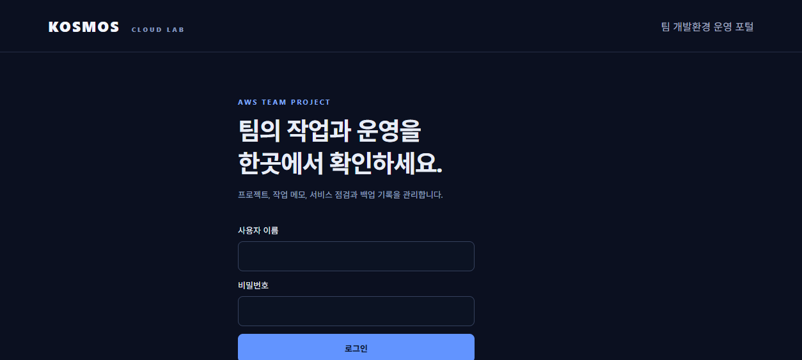
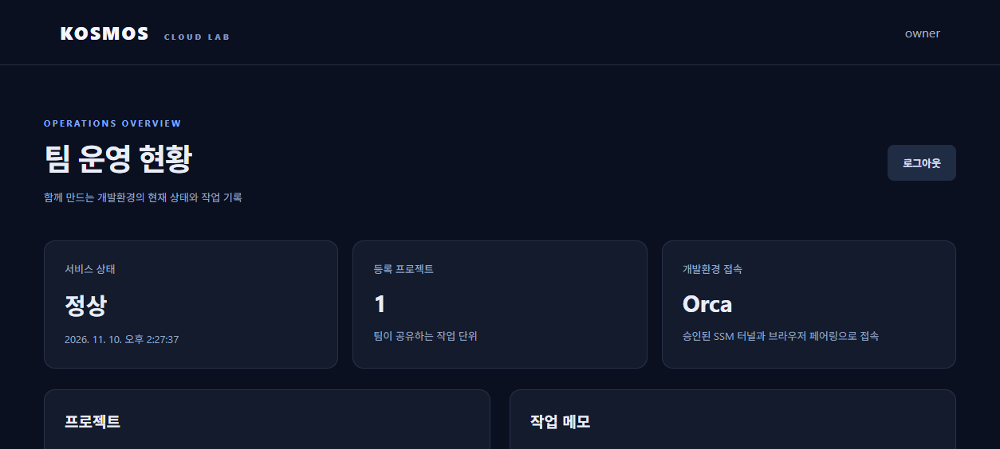

# 실제 검증 결과 — 2026-11-10 KST

| 항목 | 결과 | 근거와 한계 |
|---|---|---|
| AWS 인증 | 통과 | STS 성공. 최초 sandbox 내 endpoint 실패와 구분 |
| 플랜/크레딧 | 통과 | Free Tier API FREE/ACTIVE, 비공개 로컬 비용 기록 참조. 최종 재조회도 동일; 반영 지연 가능 |
| 새 EC2 | 통과 | 서울 t3.small 한 대, 상태 검사 system/instance ok |
| EBS/메타데이터 | 통과 | 20 GiB gp3 encrypted=true, IMDSv2 required |
| 패키지 | 통과 | Orca 1.4.255, 공식 release SHA-256 검증 |
| 자동 시작 | 통과 | orca user unit live, lingering=yes |
| 웹 번들 | 통과 | 서버 내부 및 SSM 포워딩 HTTP 200, 실제 Orca Web UI |
| 브라우저 페어링 | 통과 | 사용자 승인 후 현재 PC Chrome에 등록, URL에서 비밀값 제거된 UI 확인 |
| 웹 편집/저장 | 통과 | 웹 편집기로 main.py 수정, SSM에서 저장된 파일 내용 직접 확인 |
| Orca 터미널 실행 | 통과 | `python3 main.py` → `KOSMOS: edited in Orca Web on AWS EC2` |
| 공인 포트 차단 | 통과 | SG ingress=[], EC2 공인 주소:6768 TCP 연결 3초 시간 초과 |
| 무자격 요청 | 제한적 통과 | WS에서 무자격 runtime.status 요청을 보냈고 4001 Invalid e2ee_hello로 종료. 전체 인증·프로토콜 보안 감사는 아님 |
| 파일 보존 | 통과 | main.py 재부팅 전후 SHA-256 동일 |
| 종료 예약 유지 | 통과 | NextElapseUSecRealtime 재부팅 전후 동일 |
| 기존 브라우저 재접속 | 통과 | SSM 터널 재개·브라우저 reload 후 별도 페어링 없이 접속 |
| 터미널 재사용 | 통과 | 워크스페이스 선택 후 기존 AWS Demo 탭 복원, 새 입력으로 Python 재실행 |
| 실행 중인 프로세스의 OS 재부팅 생존 | 주장하지 않음 | 탭/작업 경로 복원과 기존 프로세스의 생존은 다른 사항 |
| 실제 자동 중지 발생 | 미검증 | 11/11 10:38:47 KST 미래 예약 |
| 실제 AI 작업 | 보류 | Codex 설치만 완료, 사용자 요청으로 로그인 나중에 진행 |
| 3인 접속/성능 | 미검증 | 현재 PC 브라우저 한 대만 검증 |
| 포털/DB/백업·복원 | 미구현 | 다음 단계 |

## 재부팅 비교
- main.py SHA-256: `cc9521e56750abead4e874ac891e89e808818b73bc17f012fb8844444456e800` (전후 동일).
- 예약: `승인된 UTC 시각` (전후 동일).
- 재부팅은 SSM 터널 연결을 끊는다. 터널을 다시 열고 브라우저를 새로고침한 뒤 워크스페이스를 선택했다.
- 재부팅 직후 브라우저 선택 전 CLI의 terminal list는 비어 있었다. 워크스페이스에 다시 연결한 뒤 기존 탭이 복원됐다. 즉 모든 세션이 사용자 개입 없이 완전 복원된다고 주장하지 않는다.

## 관찰한 제약과 수정
1. Windows 샌드박스 네트워크: 읽기 전용 AWS 조회가 실패했으나 승인된 sandbox 외부 실행으로 성공.
2. Orca explicit loopback bind: 공식 `pair`가 network_exposure_failed로 거절. 최종 wildcard bind + refuse-public + 인바운드 없는 SG + SSM 접속 사용.
3. service install 직후 CLI 호출: runtime_unavailable 발생. live/HTTP 200 확인 후 1회 재시도해 성공.
4. 한국어 Windows의 AWS CLI 출력 인코딩: cp949가 원격 Unicode 문자를 출력하지 못함. AWS_CLI_OUTPUT_ENCODING=utf-8 및 AWS_CLI_FILE_ENCODING=utf-8로 해결, 같은 기존 SSM 결과 조회 성공.
5. SSM Run Command stdout은 약 24,000자로 제한된다. 가이드 전체 JSON을 읽던 출력은 잘렸으며, 필요한 가이드 부분을 범위 제한하여 읽었다. 파일/백업 전송 경로로 이 출력을 사용하지 않는다.

## 시연 이미지
시연 이미지는 자원 정보가 보일 수 있어 비공개 로컬 검증 자료로 보관합니다.
시연 이미지는 자원 정보가 보일 수 있어 비공개 로컬 검증 자료로 보관합니다.

## 로컬 검사
모든 PowerShell 스크립트 Parser 오류 0개, 배포/검증/데모/Codex 설치 셸 `bash -n` 통과. 이는 실제 AWS/브라우저 검증과 별도로 실행했다.

## 2026-11-10 공개 포털·RDS·S3 검증
- Nginx와 Let’s Encrypt HTTPS: 외부 agent-browser에서 인증서 오류 없이 로그인 화면·인증된 대시보드 확인. 인증서 만료 2027-02-08, Certbot 갱신 타이머 설정.
- Windows 프로젝트 가상환경과 Ubuntu EC2에서 전체 unittest 17/17 통과. 테스트 클라이언트의 httpx 사용에 Starlette deprecation warning 1종이 있으며 테스트 실패는 아니다.
- 실제 RDS MySQL 8.4.13에 프로젝트/메모 저장·재조회, 포털 서비스 재시작 후 유지 확인. TLS CA·호스트 검증, 전용 앱 DB 계정 사용.
- S3 첨부 업로드·인증 다운로드 바이트 일치. 포털 익명 접근 401, S3 직접 익명 GET 403. 공개 차단 옵션 4개 모두 true.
- 실제 백업 748바이트: 프로젝트·메모·첨부 각각 1개를 별도 빈 SQLite/폴더에 복원하고 새 계정으로 복구 앱에 로그인·다운로드 비교 성공. 운영 RDS 덮어쓰기나 PITR 시험은 하지 않았다.
- 실제 Orca 서비스를 잠시 중지 → 점검 failed 기록 → EXIT 복구와 재시작 → 점검 ok 회복을 외부 HTTPS API에서 확인했다. 포털은 계속 응답했다.
- 매분 점검, 매일 UTC 00:00 백업, 3일 보관 설정. 전체 S3 저장량 확인 시 객체 4개 2,288바이트. 첨부는 44바이트다.
- 포털/nginx 활성, 자동 시작 설정 확인. 기존 EC2 자동 중지 예약 유지. RDS는 47초 먼저 중지 요청 예약. 실제 미래 종료는 미검증.
- 계정 전달용 임시 IAM 쓰기 권한과 DB 초기화 비밀번호 읽기 권한 제거를 API로 확인했다.
- 미검증: 실제 AI 요청, 3인 동시 접속, RDS 스냅샷/PITR 복원, 자동 종료 시각의 실제 발생.

## Orca·Webmin 통합 후속 작업
[연결 검증 기록](orca-access-verification.md)에 실제 확인 범위, 미검증 항목과 로컬 준비 변경을 구분했다. 기존 종료 예약을 유지하며 사용자 요청으로 서버는 재시작하지 않는다.

## 팀 운영 추가 기능 (2026-11-11, 로컬)
[팀 운영 절차](team-operations.md)에 적용 순서와 미적용 항목을 기록했다. 추가 유료 AWS 자원이나 알림 서비스를 생성하지 않았다. 로컬 구현·검증은 운영 배포/메일 발송/2FA 등록과 구분한다.

## 2026-11-11 최신 배포 검증
GitHub 기능 브랜치 091ca9c push 후 [CI 실행](https://github.com/kosmos-s/aws-teamproject/actions/runs/42955132431)이 성공했다. EC2에 같은 릴리스를 배포하고 39개 테스트를 실행했다. RDS available 이후 서비스 4개가 active, /health가 ok임을 확인했다.
탄력적 IP를 기존 EC2에 연결했고 조회 결과의 연결 대상이 일치했다. DNS 변경 전 고정 IP로 해석을 제한하되 HTTPS 호스트 이름과 인증서 검증을 유지해 /health 200, 비인증 관리자 API 401, 인증 후 세션/프로젝트/관리자 사용자/운영 현황 200, Orca 정적 화면/Webmin 로그인 화면 200, 로그아웃 후 프로젝트 API 401을 확인했다. 이는 일반 DNS 접속이나 Orca 편집·터미널 실행 성공을 뜻하지 않는다.
서버 타이머는 EC2 13:47:23 KST/RDS 13:46:30 KST이며, 같은 시각의 AWS 일회성 종료 예약이 enabled임을 확인했다. 이 기록 시점에 미래 종료 발생 자체는 미검증이다.

## 2026-11-11 강의 시연 추가 검증
사용자 추가 승인으로 ALB와 CloudFront/별도 비공개 S3 OAC를 실제 배포했다. ALB healthy·/health 200, CloudFront Deployed·HTTPS 200, S3 원본 403을 확인했다. 정상 DNS로 포털/Orca 연결, 공개 Orca 터미널 실행과 파일 저장·원본 복구, 로그아웃 후 활성 WebSocket 1008 종료(0.02초)를 검증했다. ALB/CloudFront 시연 자원은 오늘 13:47 종료 후 정리한다. [구성·검증·정리 범위](course-demo.md)

EC2에서 새 코드 백업 명령으로 Git HEAD를 백업하고 별도의 빈 /var/tmp 복원 대상으로 복구했다. 복원 README가 원본 커밋 blob과 바이트 단위로 같고 운영 README의 기존 미커밋 변경이 유지됨을 확인했다. 이 검증은 코드 파일 복원이며 서버 전체 복구나 AI 작업 재개를 의미하지 않는다.

## 최종 확인 — 2026-11-11 13:51 KST
- 승인된 종료 시각에 EC2 stopped 확인, RDS도 stopped 확인. 운영 시간을 연장하지 않았다. 현재 공개 포털/Orca/Webmin은 중지 상태다.
- EC2 중지 후에도 EIP 연결과 동일 주소가 유지됨을 AWS에서 확인했다. 중지 후 재시작 시험까지 추가 수행하지는 않았다.
- 시연 ALB, target group, 전용 SG, CloudFront distribution, OAC, 별도 정적 S3 버킷은 각각 명시적인 NotFound/404 응답으로 삭제 확인했다. 기존 RDS/EBS/첨부·백업 S3/EIP는 보존했다.
- 일회성 Scheduler 예약은 실행 후 모두 사라졌고, 이번에 만든 두 임시 Scheduler IAM 역할과 인라인 정책도 제거했다.
- RDS 자동 재시작 예정은 2026-11-18 13:50:51 KST로 조회됐다. 중지 상태에서도 저장 비용이 남으며, 재시작 이후에는 컴퓨팅 비용이 다시 발생한다. 최종 삭제나 운영 연장은 별도 결정이 필요하다.
- EIP는 중지 중에도 $0.005/시간(30일 약 $3.60)이 남는다. EBS/RDS 저장·기존 S3도 별도다. 최종 청구액이나 크레딧 잔액은 실시간 추정과 구분한다.

## 이력 UI 실제 검증 — 2026-11-11
기존 39개 테스트와 JavaScript 문법 검사, 배포 셸 bash -n 통과. 최초 샌드박스 테스트는 Windows 임시 폴더 접근 거부였고 정상 실행 권한에서 39/39를 확인했다. 공개 포털에서 대시보드 마지막 섹션이 event-history임을 확인했다. 기본 3개(목록 높이 285px), 펼침 100개(최대 높이 520px·내부 스크롤), 다시 접기 3개, 자동 새로고침 뒤 펼침 상태 유지 확인. 모바일 viewport 390px에서 문서 너비도 390px로 가로 넘침이 없었다. 공개 /health ok 및 기존 종료 타이머 유지도 확인했다.

## 2026-11-11 오후 검증 (Claude Code 세션)
| 항목 | 결과 | 근거 |
|---|---|---|
| 로컬 자동 테스트 | 70/70 통과 | `python -m unittest discover -s tests` |
| GitHub Actions | 커밋 9525f52 실행 42984188943 **성공** (test 25초) | `gh run view` |
| 공개 배포 | 각 배포 후 `/health` 200, 새 API 비로그인 401 | curl (공개 도메인) |
| 실시간 갱신 | 다른 계정이 남긴 메모가 4초 안에 표시 | 로컬 데모 브라우저 확인 |
| 채팅·1:1 안 읽음 | 1:1 배지·정렬·접속 표시 동작 | 로컬 데모 브라우저 확인 |
| 관리자 Orca 연결 워커 | 서버에서 빈 대기열 1회 실행 성공, 폴더 목록 파일 생성 | SSM 결과 |
| 2인 접속 | 김건보·강태영 각자 접속 확인 | 사용자 보고 |
| RDS 스냅샷 복원 | 11개 중 10개 테이블 행 수 일치, operation_events 1행 차이(점검 타이머) / 임시 인스턴스 비공개 / 삭제 완료 | `.local/rds-restore-test-result.json` |
| 미검증 | 3인 동시 접속, 서버 AI 요청, 실제 GitHub/새 폴더 Orca 연결, 메일 발송, TOTP | — |

## 2026-11-12 사용자 보고
- **3인 접속 테스트:** 김건보·강태영·박찬욱 3인 접속 테스트를 수행했다(사용자 보고). 세부 기기·시각 기록은 시연 체크리스트에 추가한다.
- **관리자 비밀번호:** 사용자가 admin 비밀번호를 8자 이상 새 비밀번호로 변경했다(사용자 보고). `.local/portal-login.json`의 저장값은 운영자가 갱신한다.

## 2026-11-12 보안 개선·지속 변경 알림 — 로컬 검증

- 기준 main `4552706`, 작업 브랜치 `fix/review-hardening`. 실제 서버 반영과 구분한다.
- 전체 Python 회귀 테스트 **108/108 통과**. 공개 범위, 삭제 파일, 인증 시도 제한, 강제 비밀번호 변경/Orca, 200개 초과 채팅, 백업 v3, 알림 권한/확인 유지, 용량 이전, 동시 로그인/읽음/도배 제한, 암호화/일회용 코드/키 분실, 구형 TOTP 호환 롤백을 포함한다.
- Node 클라이언트 검사 **2/2 통과**: 읽음/수정 재조회 중 200개 초과 backlog를 건너뛰지 않음, 로그아웃 시 TOTP 시드·복구 코드·재인증 입력 제거.
- 새 회귀는 기존 결함에서 실패하는 것을 확인한 뒤 수정했다. 독립 읽기 전용 리뷰의 중요한 4건도 실패 회귀 또는 화면 검증 후 반영했다.
- 로컬 빈 SQLite 복구에서 FK를 켜고 그룹/제한 공개/할 일/채팅 파일 유지와 세션 제외를 확인했다. 운영 RDS 복구 성공으로 표현하지 않는다.
- 로컬 브라우저: 프로젝트 생성 → 대시보드 미확인 1개 → 모두 확인 0개, 계정 알림/용량 화면 확인. 브라우저 실행 오류 없음. 접근성 도구 응답은 검사 수가 0이므로 WCAG 준수 근거로 쓰지 않는다.
- 격리 SQLite/ASGI 동시 조회(사용자당 변경/채팅대상/알림 GET 3회): 10명 30요청 오류0, 30명 90요청 오류0, 100명 300요청 오류0. 사용자별 3회 왕복 p95는 각각 0.766/2.093/5.871초. EC2/RDS 용량 보장 수치가 아니다.
- 셸 문법, Python 컴파일, JavaScript 문법, `pip check`, diff 공백 검사를 통과했다. 고정 의존성의 Starlette TestClient/httpx 사용 중단 예정 경고는 있으나 테스트 실패는 없다.
- 운영 파일의 LF 체크섬이 기준 main과 같고 포털/브로커/Nginx/Webmin active인 것을 배포 전 읽기 전용으로 확인했다. RDS 비공개·암호화와 S3 공개 차단도 확인했다. 이 기록 이후 예약 종료나 상태 변화는 다시 조회해야 한다.
- 아직 미수행: 이번 릴리스 main 병합·원격 CI 결과·실제 서버 배포/복구·운영 MySQL 동시 부하·AI 로그인. 서버 배포/main/AWS 변경은 최신 사용자 확인 절차를 따른다.

## 2026-11-12 실제 main 릴리스 검증
- PR #6 main `37855ed52c9b8b3dfaee686f069a4ed896efb7f5`, [CI 성공](https://github.com/kosmos-s/aws-teamproject/actions/runs/43148499740). 서버 릴리스 전체 파일 체크섬 일치.
- 실제 RDS 스키마 35개 테이블 및 TLS 확인. TOTP 암호화 키 0600, 기존 TOTP 설정 1건의 복호화 호환 검사 통과(값 출력 없음).
- 운영 RDS/S3 논리 백업 235,694바이트를 별도 빈 SQLite/파일 폴더에 복구. 24개 업무 테이블·97행 및 파일 체크섬 검증. 원본 운영 데이터 덮어쓰기 없음.
- 정상 DNS/유효 TLS: /health 200, /api/projects·/api/notices·/api/admin/diagnostics·/orca/web-index.html·/webmin/ 모두 비로그인 401. 새 JS 자산 200, 잘못된 Origin 403, S3 익명 요청 403.
- 공개 SG 인바운드는 80/443. RDS SG의 CIDR 인바운드 없음, 비공개/암호화·추가 모니터링 비활성, S3 공개 차단 4개 모두 활성, 기존 EIP 유지와 기존 S3 삭제 권한 확인.
- 설치 중 패키지 읽기 권한 문제는 복구 후 위 검증을 다시 수행했다. 후속 셸 회귀는 서비스 초기화 실패를 강제로 만들고 구형 코드/TOTP 호환 복구가 실제 실행되는 것을 확인한다.
- 이 결과는 사용자 100명 운영 수용, 실제 AI 실행, 원래 PPT 바이너리 최신화 또는 RDS 스냅샷/PITR 복구의 증거가 아니다.

## 2026-11-14 프로젝트 소유자·Deploy key — 로컬 최종 검증

- 기능 브랜치 `feat/project-owner-deploy-key`, 기준 main `416621e`. 원격 main 동일 여부를 확인했다. 이 기능에 대한 서버 배포·AWS 변경은 수행하지 않았다.
- Python 전체 **129/129** 통과. 소유자/타인/관리자 권한, 이전·계정 삭제 차단, 이름 확인 후 포털만 삭제, 선택 GitHub 주소 원자적 생성, 공개키 전용 API, 임시 실제 OpenSSH 키 생성/제거, SSH 443·엄격 호스트 키 설정, 작업 취소·오래된 DB 스냅샷, 구형 연결 충돌, v4 복원과 v3 호환을 포함한다.
- 독립 ECC 읽기 전용 리뷰에서 중요한 문제 3건을 찾았다. ACL 쓰기 트랜잭션 재인가, 소유권 이전 시 키 정리 작업 보존, 구형/신규 연결 대기열 충돌을 회귀 4건으로 먼저 재현한 뒤 수정했다. 전체 테스트를 다시 통과했다.
- Node 클라이언트 **2/2**, 변경 JS 3개 문법, Bash 스크립트 **8개** 문법, Python compileall, pip check, git diff --check 통과.
- 로컬 브라우저에서 선택 GitHub 주소 프로젝트 생성, 소유자 설정·작업 대기 표시, 이름 변경, 390px 화면의 가로 넘침 없음(문서 폭 390px), 로그아웃 시 설정/프로젝트 카드 제거를 확인했다. 당시 브라우저 실행 오류 없음. 다른 팀원 화면의 최종 브라우저 확인은 세션 손실로 완료하지 못했으며 해당 권한 거부는 API 테스트로 확인했다.
- Git·Orca 네트워크 동작은 테스트에서 모의 처리했다. 실제 GitHub 공개키 등록·SSH/비공개 clone·push, Linux 서버 파일 권한/심볼릭 링크, 실제 MySQL 동시성, AWS/S3와 배포 UI는 별도 승인 후 검증할 항목이다. 로컬 SQLite WAL 스냅샷 시험을 실제 MySQL 검증으로 표현하지 않는다.
